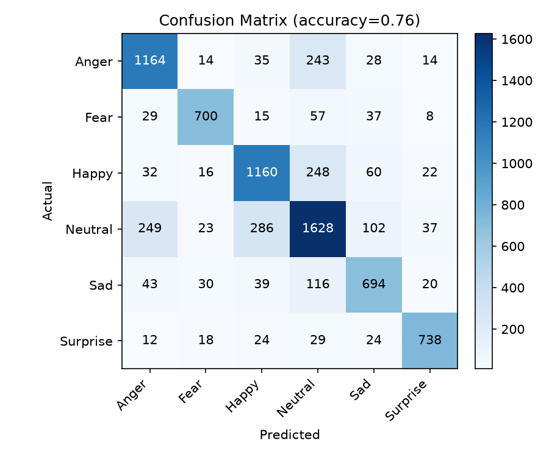

# Harf: Text Emotion Detector AI

Harf is an emotion detection system for **Roman Urdu / English code-switched text**. It classifies messages into six emotions and can analyze entire WhatsApp chats with sender-wise emotion breakdowns.

**Emotion classes:** Anger · Fear · Happy · Neutral · Sad · Surprise

---

## Features

- Hybrid model combining **TF-IDF + Logistic Regression** with an **XLM-RoBERTa** transformer
- Confidence-based arbitration (3 rules) to choose between the two models' predictions
- Streamlit web app with:
  - Single-message emotion prediction
  - Batch analysis of exported WhatsApp chats
  - Sender-wise emotion charts
  - CSV export of results
- Command-line prediction scripts for each model
- Evaluation scripts that generate accuracy metrics and a confusion matrix

---

## How It Works

1. **Classical model:** TF-IDF features feed a Logistic Regression classifier. It is fast and strong on short, keyword-driven messages.
2. **Transformer model:** XLM-RoBERTa handles multilingual and code-switched context better.
3. **Ensemble:** Both models output a prediction and a confidence score. Three confidence-based rules decide which prediction wins when they disagree.

**Performance:** Accuracy improved from **63% to 76%** after fixing a class imbalance issue by merging in a Roman Urdu emotion corpus (`ruemocorp_annotated.csv`).

---

## Project Structure

```
Harf/
├── .streamlit/
│   └── config.toml                 # Streamlit configuration
├── data/                           # Datasets (not included in the repo)
│   ├── augmented_emotions.csv
│   ├── emotion_dataset.csv
│   ├── ruemocorp_annotated.csv
│   └── test_data.csv
├── models/
│   └── model.joblib                # Trained TF-IDF + Logistic Regression model
├── output/
│   ├── confusion_matrix.png        # Evaluation confusion matrix
│   └── metrics.txt                 # Evaluation metrics
├── pic_source/
│   └── bg.jpg                      # App background image
├── src/
│   ├── accuracy_testing.py         # Accuracy testing
│   ├── check_labels.py             # Check label distribution
│   ├── dataset_conversion.py       # Convert datasets to the training format
│   ├── dataset_download.py         # Download datasets
│   ├── diagnose.py                 # Diagnostics
│   ├── predict.py                  # Predict with the classical model
│   ├── predict_ensemble.py         # Predict with the hybrid ensemble
│   ├── predict_pretrained.py       # Predict with the XLM-RoBERTa model
│   ├── testing_ensemble.py         # Evaluate the ensemble
│   ├── train_dataset.py            # Train the classical model
│   └── whatsapp_parser.py          # Parse exported WhatsApp chats
├── app.py                          # Streamlit app
├── requirements.txt
└── README.md
```

---

## Installation

**Requirements:** Python 3.9+ and pip. A GPU is optional, since the transformer runs on CPU too, just more slowly.

```bash
# 1. Clone the repository
git clone https://github.com/mahgulkhan/HARF-Emotion-Detection-AI.git
cd HARF-Emotion-Detection-AI

# 2. (Recommended) Create a virtual environment
python -m venv venv
source venv/bin/activate        # Windows: venv\Scripts\activate

# 3. Install dependencies
pip install -r requirements.txt
```

`requirements.txt` installs:

| Package | Used for |
|---------|----------|
| streamlit | Web app |
| pandas, numpy | Data handling |
| scikit-learn | TF-IDF + Logistic Regression |
| joblib | Saving/loading the trained classical model |
| matplotlib | Charts |
| torch, transformers | XLM-RoBERTa transformer model |

> The first run downloads the XLM-RoBERTa weights from Hugging Face, so an internet connection is needed once.

---

## Usage

### 1. Run the app

A trained model is included in `models/`, so you can run the app straight after installing.

```bash
streamlit run app.py
```

Then open the URL shown in the terminal (usually `http://localhost:8501`).

**Single message:** type or paste a message and click Predict.

**WhatsApp chat analysis:**
1. In WhatsApp, open a chat → **⋮ / More → Export chat → Without media**.
2. Upload the exported `.txt` file in the app.
3. View per-message emotions and sender-wise emotion charts.
4. Click **Download CSV** to export the results.

### 2. Predict from the command line

```bash
# Classical model only
python src/predict.py "aaj bohot khush hoon"

# Transformer only
python src/predict_pretrained.py "aaj bohot khush hoon"

# Hybrid ensemble (recommended)
python src/predict_ensemble.py "aaj bohot khush hoon"
```

Example output:

```
Text:       aaj bohot khush hoon
Emotion:    Happy
Confidence: 0.91
```

### 3. Train the model (optional)

Datasets are not included in this repository. Create a `data/` folder and add the dataset files (see [Dataset](#dataset)), then run:

```bash
python src/train_dataset.py
```

This retrains the classical model and overwrites `models/model.joblib`.

### 4. Evaluate

```bash
python src/testing_ensemble.py
python src/accuracy_testing.py
```

Results are written to the `output/` folder (`metrics.txt` and the confusion matrix).

---

## Dataset

Datasets are not included in the repository. Place these files in `data/`:

| File | Description |
|------|-------------|
| `emotion_dataset.csv` | Base emotion dataset |
| `augmented_emotions.csv` | Augmented training data |
| `ruemocorp_annotated.csv` | Roman Urdu emotion corpus, merged in to fix class imbalance |
| `test_data.csv` | Held-out test set |

---

## Results

| Version | Accuracy |
|---------|----------|
| Before dataset merge | 63% |
| After merging Roman Urdu corpus | 76% |



---

## Roadmap (Phase 2)

- Live, real-time emotion detection on **WhatsApp Web** via a browser extension
- Possible Android integration afterwards

---

## Tech Stack

Python · scikit-learn · PyTorch · Hugging Face Transformers (XLM-RoBERTa) · Pandas · NumPy · Matplotlib · Joblib · Streamlit

---

## Author

**Mah Gul Khan**
BS Computer Science, UET Lahore
[GitHub](https://github.com/mahgulkhan/HARF-Emotion-Detection-AI) · [LinkedIn](https://lnkd.in/p/ddMfya5N) · [Portfolio](https://mahgulkhan.github.io)